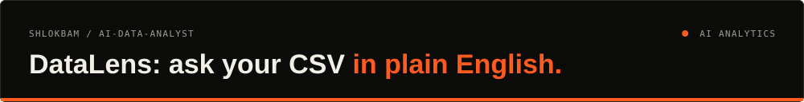
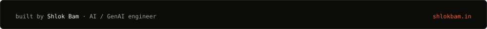

<div align="center">




<a href="#what-it-does">What it does</a> · <a href="#stack">Stack</a> · <a href="#run-it">Run it</a> · <a href="docs/DETAILS.md">Full notes</a>

</div>

Upload a CSV, ask questions in plain English, and get statistical answers, auto-generated charts and a PDF report of the whole conversation.

## What it does

- **Instant summary:** pandas profiles every uploaded file before you ask anything.
- **Questions in plain English:** the LLM gets the data summary plus the conversation so far, so follow-ups keep their context.
- **Charts on request:** the model picks a chart type (bar, line, scatter, histogram or pie) and Matplotlib draws it on the server.
- **Saved analyses:** every chat is stored per user, and you can switch between them from the sidebar.
- **PDF export:** a title page, the Q&A and the charts in one report.
- **Accounts:** sign-up and login with hashed passwords.

## Stack

| Area | Tools |
| :--- | :--- |
| App | Flask, Flask-Login, Flask-SQLAlchemy, vanilla JS |
| AI | Groq API, Llama 3.3 70B |
| Data and charts | pandas, Matplotlib |
| Reports | ReportLab |
| Hosting | Render blueprint with PostgreSQL ([`render.yaml`](render.yaml)); SQLite locally |

## Run it

```bash
python -m venv .venv && source .venv/bin/activate
pip install -r requirements.txt
# .env: GROQ_API_KEY, SECRET_KEY, UPLOAD_FOLDER=uploads
python app.py        # http://localhost:5000
```

## Roadmap

- [ ] ⚠️ Move off `llama-3.3-70b-versatile`, which Groq retired in October 2026, and add a fallback model
- [ ] Rename `gemini_helper.py` to match the provider it actually uses (Groq)

---

<div align="center">

<a href="https://shlokbam.in"></a>

<a href="https://shlokbam.in">shlokbam.in</a> · <a href="https://www.linkedin.com/in/shlokbam/">LinkedIn</a> · <a href="https://github.com/shlokbam">More projects</a>

</div>
